# WinFix AI — Voice Transcription Root Cause and Repair Report

## 1. Executive Summary & Root Cause Diagnosis

### The Defect
When a user recorded audio through the browser microphone or uploaded an audio file without typing optional notes, the application produced:
- Problem: `"Interactive Troubleshooting Guide: Spoken inquiry"`
- Domain: `General`

### The Actual Root Causes
1. **Fallback Logic Overwriting Transcripts with User Notes**:
   In `agent/voice_diagnostics.py` (lines 273 and 297), when transcription was not immediately available or returned empty text, the orchestrator substituted `transcript = VoiceTranscript(text=notes_text, ...)`. In `app.py`, if the transcript was empty, it defaulted to `tutor_voice_context or "Spoken inquiry"`.
2. **Personal Tutor & Autopilot Multimodal Key Mismatch**:
   In `agent/voice_diagnostics.py`, the diagnostic payload passed `"spoken_transcript"`, but `modes/personal_tutor.py` checked `v_ev.get("transcript")`, falling back to `"Spoken voice input recorded."`.
3. **Browser Audio Container & Decoding Robustness**:
   Streamlit's `st.audio_input` sends browser-recorded audio (WebM/Opus or WAV). Passing raw `io.BytesIO` directly to Whisper without pre-decoding led to silent failures when header extensions varied. FasterWhisper was also not iterating and joining all returned Whisper generator segments.
4. **Missing Transcript Quality Gate and Confirmation UI**:
   The UI immediately generated a diagnostic flow on transcription rather than displaying what was heard, allowing the user to review/edit the transcript, and confirming before running diagnostics.

---

## 2. Broken Code Paths vs. Repaired Code Paths

```mermaid
graph TD
    subgraph "Before Repair (Broken)"
        A1[Microphone Audio / WebM] --> B1[faster-whisper fails or returns empty]
        B1 --> C1{Optional notes?}
        C1 -- No --> D1[Default to 'Spoken inquiry']
        C1 -- Yes --> E1[Overwrite transcript with notes]
        D1 --> F1[Domain: GENERAL]
        E1 --> F1
        F1 --> G1[Generic System Baseline Flow]
    end

    subgraph "After Repair (Authoritative Flow)"
        A2[Microphone Audio / WebM / WAV] --> B2[PyAV In-Memory 16kHz Float32 PCM Decode]
        B2 --> C2[Local faster-whisper Model]
        C2 --> D2[Multi-segment Concatenation & Normalization]
        D2 --> E2{Transcript Quality Gate}
        E2 -- Empty / Inaudible --> F2[Explicit Failure Notice: Retry / Upload / Type]
        E2 -- Valid Speech --> G2[Display 'What I Heard' + Optional Context]
        G2 --> H2[User Review / Confirm]
        H2 --> I2[Domain Classifier & Tool Registry]
        I2 --> J2[Domain-Specific Troubleshooting Flow]
    end
```

---

## 3. Files Modified

| File | Changes Made |
| :--- | :--- |
| [`ai/voice_transcriber.py`](file:///c:/Users/karth/OneDrive/Desktop/WinFix-AI/ai/voice_transcriber.py) | Added PyAV-backed in-memory PCM decoding, multi-segment concatenation, auto language detection, and `is_valid_transcript` quality gate function. Fixed `MockLocalSTTProvider` empty string handling. |
| [`agent/voice_diagnostics.py`](file:///c:/Users/karth/OneDrive/Desktop/WinFix-AI/agent/voice_diagnostics.py) | Eliminated fallback to `notes_text` as transcript; enforced transcript as primary input; unified diagnostic payload keys (`transcript` & `spoken_transcript`); returned explicit `VoiceStatus.TRANSCRIPT_EMPTY` / `TRANSCRIPTION_UNAVAILABLE`. |
| [`modes/personal_tutor.py`](file:///c:/Users/karth/OneDrive/Desktop/WinFix-AI/modes/personal_tutor.py) | Fixed voice evidence parsing to check both `transcript` and `spoken_transcript` and `intent` / `inferred_intent`. |
| [`app.py`](file:///c:/Users/karth/OneDrive/Desktop/WinFix-AI/app.py) | Upgraded all 3 Voice UI locations (Personal Tutor, Autopilot, Main Voice Diagnostics) with 2-step verification (`Transcribe` $\rightarrow$ `What I heard` $\rightarrow$ `Formulate Flow`), quality gate alerts, and eliminated `"Spoken inquiry"` fallback strings. |
| [`tests/test_voice_diagnostics.py`](file:///c:/Users/karth/OneDrive/Desktop/WinFix-AI/tests/test_voice_diagnostics.py) | Added comprehensive 20-case regression suite covering all audio formats, quality gates, domain mapping, Tutor, Autopilot, and session isolation. |
| `build/dist/WinFixAI/*` | Synced all modified modules to build distribution. |

---

## 4. Technical Specifications

- **Audio Container Formats Accepted**: WAV (RIFF/WAVE PCM), WebM (EBML / Opus), MP3 (ID3), OGG (OggS), FLAC, M4A/MP4.
- **Audio Decoding Mechanism**: Native in-memory PyAV (`av`) decoding to 16,000 Hz single-channel mono `float32` arrays (zero subprocess / zero shell execution).
- **Speech-to-Text Model**: Local offline `faster-whisper:tiny.en` (CPU / int8 quantized) with automatic language detection and full segment concatenation.
- **Security Invariant**: Strictly zero `subprocess`, `os.system`, `os.popen`, `eval`, `exec`, or `shell=True`. Tool registry strictly pinned at 59 verified tools (49 SAFE, 10 MEDIUM, 0 HIGH).

---

## 5. Behavior Comparison (Before vs. After)

| Scenario | Input | Before Fix | After Fix |
| :--- | :--- | :--- | :--- |
| **Voice Only (Wi-Fi)** | *"My Wi-Fi keeps disconnecting every few minutes."* | `Interactive Troubleshooting Guide: Spoken inquiry` Domain: `General` | `Interactive Troubleshooting Guide: My Wi-Fi keeps disconnecting every few minutes.` Domain: `Network` |
| **Voice + Notes** | Voice: *"My Wi-Fi keeps disconnecting"* Notes: *"After update"* | Transcript replaced by notes or general fallback | Primary: *"My Wi-Fi keeps disconnecting"* Context: *"After update"* Domain: `Network` |
| **Inaudible Audio** | Silent audio / empty mic | Fallback to `"Spoken inquiry"` generic flow | Explicit Alert: *"Your recording was received, but no intelligible speech could be recognized."* Options: Retry / Upload / Type |
| **STT Unavailable** | FasterWhisper not installed | Silent replacement with notes or general flow | Explicit Alert: *"Local speech-to-text model is unavailable."* Option: Type in Written Description |

---

## 6. Verification and Test Results

### Automated Test Suites
- `tests/test_voice_diagnostics.py`: **52/52 PASSED**
- `tests/test_end_to_end_acceptance.py`: **27/27 PASSED**
- `winfix_launcher.py --check-only`: **13/13 Subsystems READY** (59 tools registered)

### 20-Point Regression Checklist
1. Valid WAV → transcript: **PASSED (REAL)**
2. Valid WebM/Opus → transcript: **PASSED (REAL)**
3. Multiple Whisper segments → one complete transcript: **PASSED (REAL)**
4. Empty transcript: **PASSED (REAL)**
5. STT model unavailable: **PASSED (REAL)**
6. Invalid audio: **PASSED (REAL)**
7. Audio decode failure: **PASSED (REAL)**
8. Voice → Network domain: **PASSED (REAL)**
9. Voice → Storage domain: **PASSED (REAL)**
10. Voice → Performance domain: **PASSED (REAL)**
11. Voice → Personal Tutor: **PASSED (REAL)**
12. Voice → Autopilot: **PASSED (REAL)**
13. Optional notes absent: **PASSED (REAL)**
14. Optional notes present: **PASSED (REAL)**
15. Optional notes must not replace transcript: **PASSED (REAL)**
16. Transcript survives Streamlit rerun/session state: **PASSED (REAL)**
17. Failed transcription does not create "Spoken inquiry": **PASSED (REAL)**
18. Failed transcription does not start generic diagnostics: **PASSED (REAL)**
19. Voice transcript stored as VOICE evidence: **PASSED (REAL)**
20. Session isolation: **PASSED (REAL)**

---

## 7. Remaining Limitations & Operating Notes

- Local transcription requires the offline `faster-whisper` package and downloaded model weights (e.g. `tiny.en` or `base`).
- In low-signal environments or loud background noise, Whisper confidence may drop; the interactive UI enables users to review and edit what was heard before launching any automated troubleshooting.
